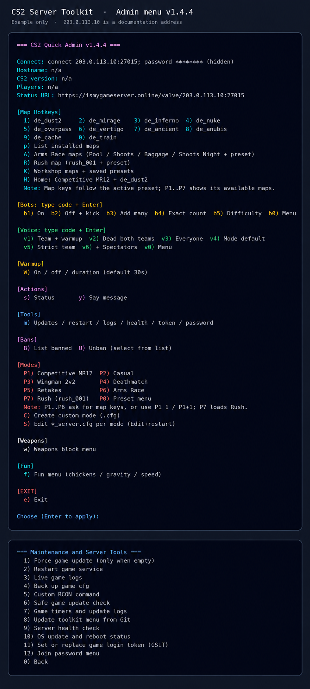

# CS2 Server Toolkit

A guided installer and terminal admin console for Counter-Strike 2 dedicated servers on Ubuntu. Set up a server with a few commands and prompts, then manage matches and maintenance from one menu.

The installer downloads CS2 through SteamCMD, creates a user-level `systemd` service, and configures scheduled updates. It can be run again to refresh toolkit files while preserving the game installation and server settings.

## Features

- **Guided setup:** Installs the game and required tools, creates the service, and starts the server.
- **Match control:** Switch between supported modes and maps, manage bots, voice, warmup, weapon restrictions, and bans from `~/admin-cs2`.
- **Workshop support:** Add individual maps or a public collection and save a Competitive, AWP, or Scout profile for each map.
- **Player-aware maintenance:** Check for game updates, defer disruptive work while players are online, and schedule OS updates and reboots when the server is empty.
- **Server operations:** View health and logs, run RCON commands, restart the service, and manage the join password or Steam game server login token.

## Requirements

- Ubuntu 24.04 on a VPS or dedicated server
- At least 4 GB RAM (8 GB or more recommended) and about 60 GB free disk space
- A non-root Linux account with `sudo` access for installation
- A [Steam Game Server Login Token](https://steamcommunity.com/dev/managegameservers) for a public server

## Quick start

Create a dedicated game account, then switch to it:

```bash
sudo adduser cs2server
sudo usermod -aG sudo cs2server
su - cs2server
```

Clone the repository and run the guided installer:

```bash
git clone https://github.com/kiyanibehzad/cs2-server-toolkit.git
cd cs2-server-toolkit
./install.sh
```

The installer asks for the public server IP, RCON password, server name, and optional join password and GSLT. Run it as the game account, not root. The first installation downloads CS2 and may take time depending on your connection.

Open the admin console after installation:

```bash
~/admin-cs2
```

## Admin console



Type a choice and press Enter to apply it. The menu groups everyday controls on the main screen and puts maintenance and credentials under **Tools** (`m`).

| Control | What it does |
| --- | --- |
| `H` | Return to the default Competitive MR12 preset on Dust II. |
| `P1`–`P7` | Choose a game preset and a compatible map. `P1 1` selects Competitive on Dust II. |
| `A`, `R` | Start Arms Race or Rush with their supported map. |
| `K` | Browse added Workshop maps and collections; play a map with its saved profile. |
| `b1`–`b5`, `b0` | Enable or remove bots, change their count and difficulty, or open the full bot menu. |
| `v1`–`v6`, `v0` | Change live voice rules or restore the current mode's defaults. |
| `W`, `w` | Set persistent warmup and weapon restrictions. |
| `m` | Open update, service, log, health, token, and join-password tools. |

### Modes and maps

Preset choices show only maps supported by the selected mode and installed on the server. Competitive, Casual, Wingman, Deathmatch, Retakes, Arms Race, and Rush have separate map pools. Use `P1 1` or `P1+1` to select a preset and map together; enter several map keys such as `1+2` to apply them in order. The final map stays active. Changing a live map interrupts the current match.

The Home shortcut (`H`) restores Competitive MR12 on Dust II. For scripts, the same action is `~/cs2-ds/cs2-admin.sh default`.

### Workshop maps

Open `K` to add a map by Workshop URL or connect a public Workshop collection. Each map can use the Competitive, AWP-only, or Scout-only profile. The toolkit saves the collection and map profiles across updates. A personal Steam subscription on your PC does not automatically add that item to the server menu; use a map URL or public collection instead. The first map download may take time.

### Bots, voice, and warmup

Bot count and difficulty settings persist across map changes and restarts. The voice shortcuts change live communication rules through RCON and enable server voice when a live mode is selected; `v4` restores the current mode's original voice settings. The voice status also shows whether server voice is enabled. Voice choices are temporary and may reset when the mode or server restarts. `W` saves whether warmup is enabled and its duration; the initial server-wide duration is 30 seconds.

### Maintenance and access

The **Tools** menu (`m`) contains game updates, service restart, logs, config backup, RCON, timer status, and health checks. Use `m` → `11` to replace the GSLT and `m` → `12` to set or clear the join password. The token is entered without echoing it, saved privately, and used at the next game start; when the service is running, the menu offers a restart to apply it immediately.

Start or stop the game service directly when needed:

```bash
systemctl --user start cs2-ds
systemctl --user stop cs2-ds
journalctl --user -u cs2-ds -f
```

## Configuration and game modes

`.update.env` holds the toolkit's private launch settings, including GSLT,
network settings and RCON credentials. `start.sh` reads it on every start.
GSLT is passed to the game at launch; `cs2server.cfg` is no longer a second
toolkit source for it. Existing duplicate GSLT lines are removed during
reinstallation after a restricted backup is made.

The weapon menu saves the chosen list in `~/cs2-ds/toolkit-config/blocked-weapons.txt`.
The bot menu saves its explicit choices in `~/cs2-ds/toolkit-config/bots.txt`.
The initial 30-second warmup and later menu choices are saved in
`~/cs2-ds/toolkit-config/warmup.txt`.
The toolkit generates `game/csgo/cfg/cs2_toolkit.cfg` and includes it from
`cs2server.cfg` and the supported `gamemode_*_server.cfg` override files.
These includes are recreated at server start. Valve's `gamemode_*.cfg` base
files are never edited by the toolkit. Until you use the bot menu, each mode's
existing bot defaults still apply. The menu's Fun and Voice settings are temporary;
the join password is persistent in `.update.env` and `cs2server.cfg`.

Mode switches set `game_type`, `game_mode`, `sv_game_mode_flags` and
`sv_skirmish_id` before the map loads, then read back the resulting values.
The Competitive preset also reapplies and checks MR12 overtime settings.

### Your own mode overrides (`*_server.cfg`)

CS2 loads a base game-mode config and then (if present) a **server override** with the suffix `_server.cfg`.  
This lets you keep your persistent settings separate from Valve defaults and from the toolkit menu.

### Load order (per map change / restart)

1. `gamemode_<mode>.cfg` (Valve defaults)  
2. `gamemode_<mode>_server.cfg` (your overrides — takes priority)  
3. Anything you manually `exec` (e.g., via admin menu)  

For example, Competitive uses `gamemode_competitive_server.cfg`, Wingman uses
`gamemode_competitive2v2_server.cfg`, Retakes uses
`gamemode_retakecasual_server.cfg`, and Arms Race uses
`gamemode_armsrace_server.cfg`. Rush uses `gamemode_rush_server.cfg`. The file
stem does not always match the menu
name.

### File locations

Put your files here (created if missing):
```
/home/<user>/cs2-ds/game/csgo/cfg/gamemode_competitive_server.cfg
/home/<user>/cs2-ds/game/csgo/cfg/gamemode_casual_server.cfg
/home/<user>/cs2-ds/game/csgo/cfg/gamemode_deathmatch_server.cfg
...
```

> If your build uses `game/cs2/cfg/`, use that path instead. The toolkit auto-detects.

### Quick examples

**1) Competitive MR12 (overtime 3+3, keep >10 players)**  
`gamemode_competitive_server.cfg`
```cfg
mp_maxrounds 24
mp_halftime 1
mp_overtime_enable 1
mp_overtime_maxrounds 6
mp_halftime_pausetimer 0
mp_overtime_halftime_pausetimer 0
mp_freezetime 15
mp_roundtime 1.92
mp_round_restart_delay 7
mp_autokick 0
sv_visiblemaxplayers 32
```

**2) Casual tweaks**  
`gamemode_casual_server.cfg`
```cfg
mp_maxrounds 15
mp_free_armor 1
mp_solid_teammates 0
sv_visiblemaxplayers 32
```

**3) Deathmatch (FFA-style)**  
`gamemode_deathmatch_server.cfg`
```cfg
mp_teammates_are_enemies 1
mp_respawn_on_death_t 1
mp_respawn_on_death_ct 1
mp_randomspawn 1
mp_freezetime 0
mp_maxrounds 0
mp_timelimit 20
mp_ignore_round_win_conditions 1
sv_visiblemaxplayers 32
```

**4) Weapon restrictions (global)**  
Use the `w` menu or `weapons-set` command. Friendly names and supported
canonical names are converted to item definition indices, which is what
`mp_items_prohibited` expects. For example:
```cfg
// AWP (9) and SSG 08 (40)
mp_items_prohibited "9,40"
```
Manual lines in other configs may override the toolkit value; the menu's saved
list is applied at the end of each supported mode override and mode switch.
Check an actual buy attempt in CS2 after changing restrictions, since a ConVar
readback alone does not prove game-rule enforcement.

**5) Fun: chickens**
Use the Fun menu to spawn chickens with `ent_create chicken`. The obsolete
`mp_enablechickens` command is not supported by the current server.

### Applying changes

- Changes in `*_server.cfg` load automatically on next **map change** or server restart.  
- To apply immediately:
  ```
  rcon exec gamemode_competitive_server.cfg
  rcon mp_restartgame 1
  ```
  (replace filename with your target mode)

### Configuration notes

- Keep permanent, “always-on” rules in the relevant `*_server.cfg`.  
- Use the admin menu for temporary Fun commands and the persistent weapon list.
- If a menu preset also changes a setting, the last executed configuration takes precedence.
- You can create **per-map** overrides using `mapname.cfg` (e.g., `de_mirage.cfg`) if needed.

---

## Updates and scheduled maintenance

Game updates and morning maintenance use separate timers with a shared lock:

- `cs2-update.timer` → daily check at 06:00
- `cs2-checkupdate.timer` → check every 30 minutes
- `cs2-daily-home.timer` → from 06:00 to noon, try every five minutes until the
  first empty moment; restart once and apply Competitive MR12 on Dust II
- `cs2-os-maintenance@<game-user>.timer` → from 06:10 to noon, try every ten
  minutes; update Ubuntu packages and reboot only if required and no real
  players are online

The schedule uses the server's local time. If RCON cannot confirm the number
of real players, maintenance waits. A daily Home restart is skipped if the
server stays occupied through the morning. The installer replaces Ubuntu's
floating `apt-daily.timer` and `apt-daily-upgrade.timer` with the root-owned,
player-safe OS timer. It preserves package configuration and does not remove
packages during upgrades. OS update and reboot logs are in
`journalctl -u cs2-os-maintenance@<game-user>.service`.

When a new build is available, the updater checks the player count through
RCON. If players are present or RCON cannot be trusted, it defers the update.
It also prevents overlapping runs and restarts a previously running server if
SteamCMD fails. A stopped server remains stopped. After SteamCMD reports
success, the updater checks the installed manifest, executable and known
public build before reporting a verified update.

Run a check or request an update manually:

```bash
~/cs2-ds/cs2-safe-update.sh --check
~/cs2-ds/cs2-safe-update.sh --force
# Existing servers can also use the familiar command:
~/update-cs2.sh
```

`--force` skips only the build comparison. It still defers while players are
connected or RCON status is unavailable.

Check timers:
```bash
systemctl --user list-timers --all | grep cs2
```

Update and server logs:

```bash
tail -f ~/cs2-ds/update.log
journalctl --user -u cs2-checkupdate.service -n 50 --no-pager
journalctl --user -u cs2-ds.service -n 50 --no-pager
```

The installer restricts `.update.env` and `cs2server.cfg` to the game user.
Do not commit these files or paste their contents into an issue: they hold
RCON credentials and possibly the GSLT.

References: [Valve Developer Community CS2 dedicated servers](https://developer.valvesoftware.com/wiki/Counter-Strike_2/Dedicated_Servers),
[Valve Developer Community legacy game-mode configuration](https://developer.valvesoftware.com/wiki/Counter-Strike:_Global_Offensive/Game_Modes),
[SteamCMD](https://developer.valvesoftware.com/wiki/SteamCMD), and
[Source RCON protocol](https://developer.valvesoftware.com/wiki/Source_RCON_Protocol).

---

## Hosting

If you need a VPS or dedicated server for CS2, you can use the author's
[iShosting referral link](https://ishosting.com/affiliate/NDk5OSM2).

## Support

If this toolkit is useful, you can support its maintenance:

- **USDT (TRC20):** `TGhctG46AciRXEudjEereW8DGvoErdkqta`  
- **USDT (BSC):** `0xCBC1861Ed594a9e39a6995e70067931A955831b6`  
- **USDT (TON):** `UQD4ctGxd4JwueIt8n3n4Ob3p1nyAMrdmkr_tYFFZqQqdNYR`

---

## License

MIT License © 2025 [Behzad Kiyani](https://github.com/kiyanibehzad)
